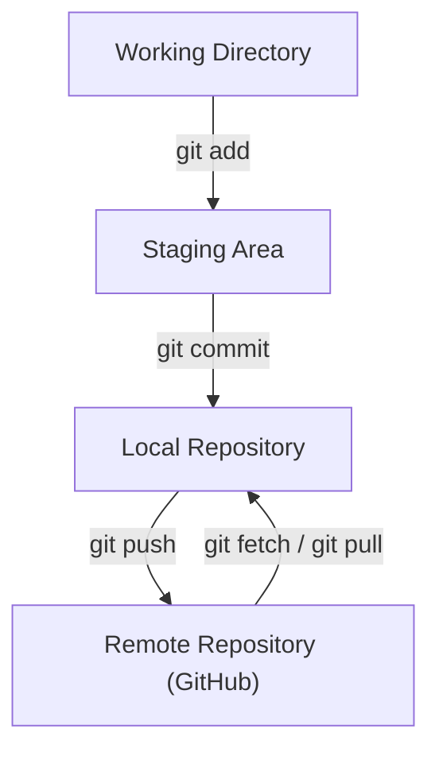

# 02 — Basic Git Workflow

## Introduction

Git provides commands that help developers track changes, prepare files for commits, save project history, and synchronize work with remote repositories.

This guide explains the essential Git commands used in everyday development and demonstrates how they work together in a typical workflow.

## 1. Understanding the Git Workflow

The basic Git workflow consists of three main areas:

1. **Working Directory:** The project files where changes are made.
2. **Staging Area:** The area where selected changes are prepared for the next commit.
3. **Local Repository:** The area where committed snapshots and project history are stored.

A remote repository, such as a GitHub repository, allows developers to share and synchronize their work.

### Basic Workflow



## 2. Checking Repository Status — `git status`

The `git status` command displays the current state of the working directory and staging area.

### Syntax

```bash
git status
```

It helps identify:
- Modified files.
- New untracked files.
- Staged changes.
- The current branch.
- Whether the local branch is synchronized with its upstream branch.

### Example

```bash
git status
```

Possible output:

```text
On branch main
Your branch is up to date with 'origin/main'.

nothing to commit, working tree clean
```

This means there are no pending changes.

## 3. Staging Changes — `git add`

The `git add` command stages changes for the next commit.

### Stage a Specific File

```bash
git add README.md
```

### Stage Multiple Files

```bash
git add file1.txt file2.txt
```

### Stage All Changes in the Current Directory

```bash
git add .
```

**Important:** Staging a file does not create a commit. It only prepares the selected changes for the next commit.

## 4. Reviewing Changes — `git diff`

The `git diff` command displays differences between versions of files.

### View Unstaged Changes

```bash
git diff
```

Displays changes in the working directory that have not yet been staged.

### View Staged Changes

```bash
git diff --cached
```

Displays changes that have been staged and are ready to be committed.

### Check for Whitespace Errors

```bash
git diff --check
```

This checks for common whitespace errors in changes, such as trailing whitespace.

## 5. Saving Changes — `git commit`

A commit records the staged changes in the local repository.

### Syntax

```bash
git commit -m "Commit message"
```

### Example

```bash
git commit -m "Add basic Git workflow documentation"
```

### Good Commit Message Practices

- Keep messages clear and meaningful.
- Describe what the commit changes.
- Avoid vague messages such as `update` or `changes`.
- Use a consistent commit message style.

A commit records a snapshot of the staged content, not automatically every change in the working directory.

## 6. Viewing Commit History — `git log`

The `git log` command displays the repository's commit history.

### Full Commit History

```bash
git log
```

### Compact Commit History

```bash
git log --oneline
```

Example:

```text
a1b2c3d Add workflow documentation
e4f5g6h Update README
```

The identifiers above are illustrative examples.

### Useful Options

```bash
git log --oneline --graph --decorate
```

Displays a compact history with a graph and branch references.

**Note:** If Git opens a pager, press `q` to exit.

## 7. Uploading Changes — `git push`

The `git push` command sends local commits to a remote repository.

### Syntax

```bash
git push <remote> <branch>
```

### Example

```bash
git push origin main
```

This pushes the local `main` branch to the `main` branch on the remote named `origin`.

For a newly created branch that does not yet have an upstream:

```bash
git push -u origin feature-branch
```

The `-u` option sets the upstream tracking relationship.

## 8. Downloading and Integrating Changes — `git pull`

The `git pull` command fetches changes from a remote repository and integrates them into the current local branch.

### Syntax

```bash
git pull <remote> <branch>
```

### Example

```bash
git pull origin main
```

Git normally performs a fetch followed by an integration step. The integration method depends on Git configuration and command options.

**Important:** Before pulling, check your working tree and understand any local changes that might be affected.

## 9. Fetching Remote Changes — `git fetch`

The `git fetch` command downloads updates from a remote repository without integrating them into the current local branch.

### Syntax

```bash
git fetch <remote>
```

### Example

```bash
git fetch origin
```

Fetching allows you to inspect remote updates before deciding how to integrate them.

### Fetch and Prune

```bash
git fetch --prune
```

Fetches updates from the remote and removes stale remote-tracking references for branches that have been deleted from the remote repository.

It does not delete your local branches.

## 10. Checking Remote Repositories — `git remote -v`

The `git remote -v` command displays configured remote repositories and their URLs.

### Syntax

```bash
git remote -v
```

Example:

```text
origin  https://github.com/username/project.git (fetch)
origin  https://github.com/username/project.git (push)
```

`origin` is the conventional name assigned to the default remote when cloning a repository.

## 11. Complete Basic Git Workflow

The following example demonstrates a common workflow for updating a project.

### Step 1: Check Repository Status

```bash
git status
```

### Step 2: Modify a Project File

Make the required changes in your editor.

### Step 3: Review Unstaged Changes

```bash
git diff
```

### Step 4: Stage the Changes

```bash
git add README.md
```

### Step 5: Review Staged Changes

```bash
git diff --cached
```

### Step 6: Commit the Changes

```bash
git commit -m "Update project documentation"
```

### Step 7: Push the Commit

```bash
git push origin main
```

The changes are now uploaded to the remote repository.

**Note:** This example assumes you are working on `main`. In collaborative projects, changes are often pushed through feature branches and pull requests instead.

## 12. Common Beginner Mistakes

- Forgetting to stage changes before committing.
- Committing without reviewing staged changes.
- Using unclear commit messages.
- Confusing `git fetch` with `git pull`.
- Pushing to the wrong branch.
- Assuming `git add` creates a commit.
- Forgetting to check the repository status.
- Assuming `git push` uploads uncommitted changes.

## 13. Best Practices

- Check `git status` regularly.
- Review changes using `git diff`.
- Stage only the files required for a commit.
- Review staged changes before committing.
- Write meaningful commit messages.
- Fetch remote changes when you need to inspect updates.
- Understand the target branch before pushing.
- Keep commits focused on related changes.

## 14. Hands-On Practice Exercises

1. Check the status of a Git repository.
2. Create or modify a text file.
3. View unstaged changes using `git diff`.
4. Stage the file using `git add`.
5. View staged changes using `git diff --cached`.
6. Commit the changes with a meaningful message.
7. View the commit using `git log --oneline`.
8. Check configured remotes using `git remote -v`.
9. Practise fetching updates using `git fetch`.
10. Push a commit to a practice branch.

## 15. Quick Revision

| Command | Purpose |
|---|---|
| `git status` | Check repository status |
| `git add` | Stage changes |
| `git diff` | View unstaged changes |
| `git diff --cached` | View staged changes |
| `git diff --check` | Check whitespace errors |
| `git commit` | Record staged changes |
| `git log` | View commit history |
| `git push` | Upload commits |
| `git pull` | Fetch and integrate remote changes |
| `git fetch` | Download remote updates |
| `git fetch --prune` | Remove stale remote-tracking references |
| `git remote -v` | View remote URLs |

---

**Previous Guide:** [01 — Git and GitHub Fundamentals](../01-git-and-github-fundamentals/README.md)

**Next Guide:** [03 — Branching and Pull Requests](../03-branching-and-pull-requests/README.md)