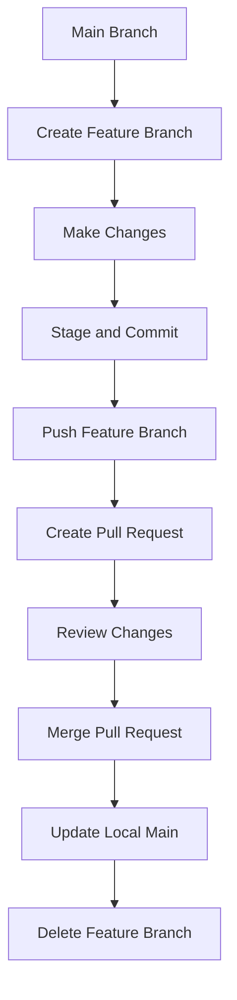

# 03 — Branching and Pull Requests

## Introduction

Git branching allows developers to work on new features, bug fixes, and improvements without directly modifying the main development branch.

A pull request (PR) is a GitHub feature that allows developers to propose changes from one branch into another, review those changes, and merge them.

This guide explains how to create and manage branches, work with feature branches, push changes to GitHub, and complete a pull request workflow.

## 1. Understanding Git Branches

A branch is an independent line of development in a Git repository.

Branches allow developers to work on changes separately without affecting the main branch.

### Why Use Branches?

- Develop new features independently.
- Fix bugs without disturbing existing code.
- Experiment with changes safely.
- Collaborate with other developers.
- Review changes before merging them.

### Common Branch Names

| Branch | Purpose |
|---|---|
| `main` | Main stable branch |
| `feature/login-page` | New feature development |
| `bugfix/navbar-error` | Bug fixes |
| `docs/update-readme` | Documentation improvements |
| `practice/git-commands` | Learning and practice |

## 2. Viewing Branches — `git branch`

The `git branch` command displays local branches.

```bash
git branch
```

The current branch is marked with an asterisk (`*`).

To display both local and remote-tracking branches:

```bash
git branch -a
```

## 3. Creating a New Branch

Use `git branch` to create a branch without switching to it:

```bash
git branch feature/new-feature
```

To create a branch and switch to it immediately:

```bash
git switch -c feature/new-feature
```

The `-c` option creates a new branch.

## 4. Switching Between Branches — `git switch`

To switch to an existing branch:

```bash
git switch main
```

To switch to another branch:

```bash
git switch feature/new-feature
```

Before switching branches, check your working directory:

```bash
git status
```

Commit or safely save your changes before switching if they could be affected.

## 5. Working with a Feature Branch

A feature branch keeps new work separate from the main branch.

Typical workflow:

```bash
git switch main
git pull origin main
git switch -c feature/new-feature
```

Make the required changes to your project files.

Then check and commit your changes:

```bash
git status
git add .
git commit -m "feat: add new feature"
```

Push the branch to GitHub:

```bash
git push -u origin feature/new-feature
```

The `-u` option sets the upstream tracking relationship. After this, you can generally use `git push` and `git pull` without specifying the remote and branch.

## 6. Understanding Pull Requests

A pull request (PR) is a request to merge changes from one branch into another.

For example:

- Source branch: `feature/new-feature`
- Target branch: `main`

Pull requests help teams review code, discuss improvements, identify problems, and maintain project quality.

### Benefits of Pull Requests

- Code review before merging.
- Discussion and collaboration.
- Change tracking.
- Better project management.
- Safer integration of changes.

## 7. Creating a Pull Request on GitHub

After pushing your feature branch:

1. Open your repository on GitHub.
2. Navigate to the **Pull requests** tab.
3. Click **New pull request**.
4. Select the target branch (`main`).
5. Select your source feature branch.
6. Review the changes shown in the comparison.
7. Click **Create pull request**.
8. Add a meaningful title and description.

Example title:

`feat: add new feature`

Example description:

- Added a new feature.
- Updated the relevant documentation.
- Tested the changes before submission.

## 8. Reviewing and Merging a Pull Request

Before merging a pull request:

1. Review the changed files.
2. Check the additions and deletions.
3. Verify the target and source branches.
4. Check for merge conflicts.
5. Confirm that required checks have passed, if configured.
6. Merge only after the changes are approved.

Common GitHub merge methods include:

| Method | Description |
|---|---|
| Merge commit | Combines branch history with a merge commit |
| Squash and merge | Combines the pull request commits into one commit |
| Rebase and merge | Replays commits onto the target branch |

These merge strategies will be explored in more detail in a later guide.

## 9. Cleaning Up After a Pull Request

After a pull request is successfully merged, the remote feature branch can usually be deleted from GitHub.

Update your local main branch:

```bash
git switch main
git pull origin main
```

Delete the local feature branch:

```bash
git branch -d feature/new-feature
```

The `-d` option safely deletes a branch that Git considers fully merged. Git refuses to delete a branch with unmerged changes using this option.

The `-D` option forces deletion, even if the branch contains unmerged changes. Use it cautiously because it can cause you to lose access to unmerged work.

To remove stale remote-tracking references:

```bash
git fetch --prune
```

This removes stale remote-tracking references for branches deleted from the remote repository. It does not delete local branches or modify your working files.

## 10. Complete Branch and Pull Request Workflow



## 11. Common Mistakes

| Mistake | Solution |
|---|---|
| Working directly on `main` | Create a separate feature branch |
| Forgetting to push the branch | Run `git push -u origin branch-name` |
| Creating a PR from the wrong branch | Check source and target branches |
| Merging without reviewing changes | Inspect the Files changed tab |
| Switching branches with unsafe uncommitted changes | Check `git status` first |
| Forgetting to update local `main` | Run `git pull origin main` |
| Keeping unnecessary merged branches | Delete merged branches when appropriate |

## 12. Best Practices

- Use descriptive branch names.
- Keep branches focused on one task.
- Create branches from an updated base branch.
- Write meaningful commit messages.
- Review changes before creating a pull request.
- Keep pull request descriptions clear.
- Review the Files changed tab before merging.
- Delete temporary feature branches after merging.
- Keep the main branch stable.

## 13. Practice Exercises

1. Display all local branches using `git branch`.
2. Display local and remote-tracking branches using `git branch -a`.
3. Create a branch named `practice/branching`.
4. Switch between `main` and `practice/branching`.
5. Create a small documentation change.
6. Stage and commit the change.
7. Push the branch to GitHub.
8. Create a pull request targeting `main`.
9. Review and merge the pull request.
10. Update your local `main` branch and clean up the merged branch.

## 14. Quick Revision

| Command | Purpose |
|---|---|
| `git branch` | List local branches |
| `git branch -a` | List local and remote-tracking branches |
| `git branch branch-name` | Create a branch |
| `git switch branch-name` | Switch branches |
| `git switch -c branch-name` | Create and switch branches |
| `git push -u origin branch-name` | Push and set upstream |
| `git branch -d branch-name` | Delete a merged local branch |
| `git fetch --prune` | Remove stale remote-tracking references |

---

**Previous Guide:** [02 — Basic Git Workflow](../02-basic-git-workflow/README.md)

**Next Guide:** [04 — Git Reset and Revert](../04-git-reset-and-revert/README.md)