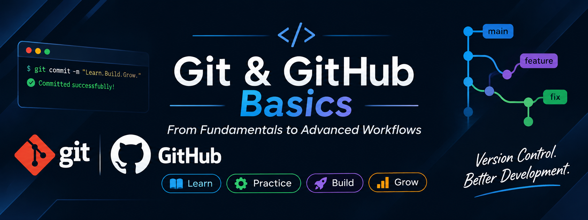

<p align="center">
  
</p>

<h1 align="center">Git & GitHub Mastery</h1>

<p align="center">
  <strong>From Git Fundamentals to Professional Development Workflows</strong>
</p>

<p align="center">
  
  
  
  
  
</p>

<p align="center">
  A practical, hands-on learning repository covering Git, GitHub,
  collaboration, automation, and professional version control workflows.
</p>

---

## About This Repository

**Git & GitHub Mastery** is a structured learning project documenting my journey from absolute Git fundamentals to professional Git and GitHub workflows.

The repository contains 16 detailed learning guides, practical command examples, exercises, troubleshooting notes, and real GitHub collaboration experience.

The focus is on understanding not only which commands to use, but also when and why to use them.

**Maintained by:** Arsh Inamdar

## Project Highlights

- 16 structured learning guides covering beginner to advanced topics.
- Hands-on practice with Git commands and repository management.
- Practical branching, merging, rebasing, and conflict-resolution exercises.
- GitHub Issues, Projects, Discussions, and Pull Request workflows.
- Git hooks, worktrees, submodules, and repository automation.
- GitHub Actions workflow for automated documentation validation.
- Real collaboration practice through a merged pull request.
- Organized documentation with examples and revision questions.

## Learning Roadmap

Explore the guides in sequence for a structured learning experience.

| No. | Guide | Topics |
|---|---|---|
| 01 | [Git and GitHub Fundamentals](01-git-and-github-fundamentals/README.md) | Version control, Git, GitHub, installation, configuration, and repositories |
| 02 | [Basic Git Workflow](02-basic-git-workflow/README.md) | Working directory, staging, commits, push, pull, and fetch |
| 03 | [Branching and Pull Requests](03-branching-and-pull-requests/README.md) | Branch management, feature branches, pull requests, and merging |
| 04 | [Git Reset and Revert](04-git-reset-and-revert/README.md) | Reset modes, reverting commits, and managing Git history |
| 05 | [Git Stash](05-git-stash/README.md) | Temporarily saving, inspecting, applying, and restoring changes |
| 06 | [Git Merge Strategies and Conflicts](06-git-merge-strategies-and-conflicts/README.md) | Merge strategies and conflict resolution |
| 07 | [Git Cherry-pick and Rebase](07-git-cherry-pick-and-rebase/README.md) | Selected commits, basic rebase, interactive rebase, and conflict resolution |
| 08 | [Git Tags](08-git-tags/README.md) | Lightweight and annotated tags, remote tags, and semantic versioning |
| 09 | [Advanced Git Inspection and Recovery](09-advanced-git-inspection-and-recovery/README.md) | Git log, diff, reflog, object inspection, and recovery |
| 10 | [Git Hooks and Automation](10-git-hooks-and-automation/README.md) | Client-side hooks, server-side hooks, and custom automation |
| 11 | [Git Worktrees and Submodules](11-git-worktrees-and-submodules/README.md) | Multiple working trees and external repositories |
| 12 | [GitHub Issues and Projects](12-github-issues-and-projects/README.md) | Issue tracking, labels, milestones, and project boards |
| 13 | [GitHub Discussions and Collaboration](13-github-discussions-and-collaboration/README.md) | Discussions, code reviews, and community collaboration |
| 14 | [GitHub Actions and CI/CD](14-github-actions-and-ci-cd/README.md) | Workflows, events, jobs, runners, and continuous integration |
| 15 | [Releases, Security and Open Source](15-releases-security-and-open-source/README.md) | Releases, versioning, repository security, and open source |
| 16 | [Professional Git Workflow](16-professional-git-workflow/README.md) | End-to-end professional Git and GitHub workflow |

## Topics Covered

### Git Fundamentals and Everyday Commands

- Version control concepts and repository structure
- Git installation and configuration
- Repository initialization and cloning
- Staging, committing, pushing, pulling, and fetching
- Inspecting repository status and commit history

### Branching and Git History

- Branch creation and management
- Feature branch workflows
- Merge strategies and conflict resolution
- Cherry-picking and rebasing
- Reset, revert, and restore
- Stashing and recovering changes
- Tags and semantic versioning

### Advanced Git and Automation

- Git hooks and custom automation
- Multiple working trees with Git worktree
- Git submodules
- Repository maintenance and troubleshooting
- GitHub Actions and CI/CD

### GitHub Collaboration

- Issues, labels, and milestones
- GitHub Projects
- Discussions and collaboration
- Pull requests and code reviews
- Releases and open-source contribution practices
- Repository security and documentation

## Practical Experience

This repository includes hands-on exercises and real GitHub activities.

| Activity | Practical work |
|---|---|
| Branching | Created feature branches and practised merging |
| Reset and recovery | Practised reset modes and Git history recovery |
| Git hooks | Created and tested a pre-commit whitespace check |
| Worktrees | Created and managed multiple working trees |
| Submodules | Practised adding, updating, and initializing submodules |
| GitHub Issues | Created and completed a documentation issue |
| Pull Requests | Created and merged [Pull Request #11](https://github.com/Arsh-Inamdar/git-github-basics/pull/11) |
| GitHub Projects | Created a project board to track learning work |
| GitHub Actions | Implemented automated documentation validation |

## Automated Documentation Validation

This repository includes a GitHub Actions workflow:

`.github/workflows/documentation-check.yml`

The workflow runs on:

- Pushes to the `main` branch
- Pull requests targeting `main`
- Manual workflow dispatch

It verifies that:

- The main README exists and is not empty.
- All 16 guide README files exist.
- Every guide README contains content.

This helps maintain documentation consistency as the repository evolves.

## Getting Started

You can explore the guides directly on GitHub or clone the repository locally.

### Prerequisites

- Git installed on your computer
- A GitHub account
- A terminal or command-line application
- A code editor such as Visual Studio Code

No advanced Git knowledge is required. The guides are designed to support beginners progressing toward advanced workflows.

### Clone the Repository

```bash
git clone https://github.com/Arsh-Inamdar/git-github-basics.git
cd git-github-basics
```

Start with Guide 01 and continue through the numbered guides.

## Learning Approach

My learning process follows a practical cycle:

1. Understand the concept.
2. Study the relevant Git commands.
3. Execute commands in a local repository.
4. Observe repository changes and Git history.
5. Practise real-world scenarios.
6. Document important lessons and troubleshooting steps.
7. Apply the concepts through GitHub collaboration.

## Repository Structure

```text
git-github-basics/
│
├── .github/
│   └── workflows/
│       └── documentation-check.yml
│
├── assets/
│   └── git-github-banner.png
│
├── 01-git-and-github-fundamentals/
├── 02-basic-git-workflow/
├── 03-branching-and-pull-requests/
├── 04-git-reset-and-revert/
├── 05-git-stash/
├── 06-git-merge-strategies-and-conflicts/
├── 07-git-cherry-pick-and-rebase/
├── 08-git-tags/
├── 09-advanced-git-inspection-and-recovery/
├── 10-git-hooks-and-automation/
├── 11-git-worktrees-and-submodules/
├── 12-github-issues-and-projects/
├── 13-github-discussions-and-collaboration/
├── 14-github-actions-and-ci-cd/
├── 15-releases-security-and-open-source/
├── 16-professional-git-workflow/
│
├── LICENSE
└── README.md
```

Each numbered guide contains its own detailed README with explanations, commands, examples, exercises, and key takeaways.

## Project Goals

This repository serves two purposes:

- To strengthen my practical understanding of Git and GitHub.
- To maintain a structured reference that can help other learners understand version control and collaborative development.

The project can continue evolving with additional exercises, real-world scenarios, and improvements based on practical experience.

## Connect

- **GitHub:** [Arsh-Inamdar](https://github.com/Arsh-Inamdar)
- **Repository:** [Git and GitHub Mastery](https://github.com/Arsh-Inamdar/git-github-basics)

## License

This project is licensed under the [MIT License](LICENSE).

---

<p align="center">
  <strong>Learning through practice. Improving through consistency.</strong>
</p>
